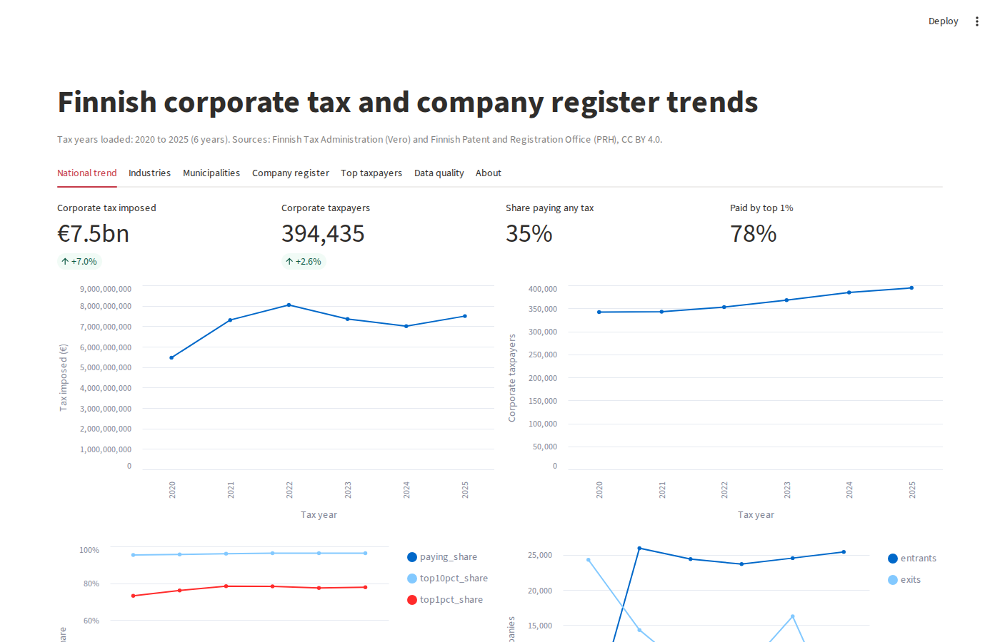
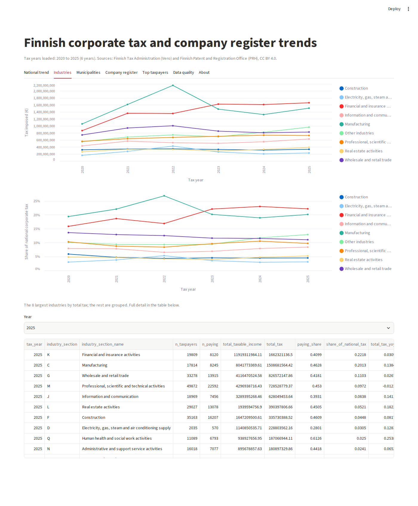
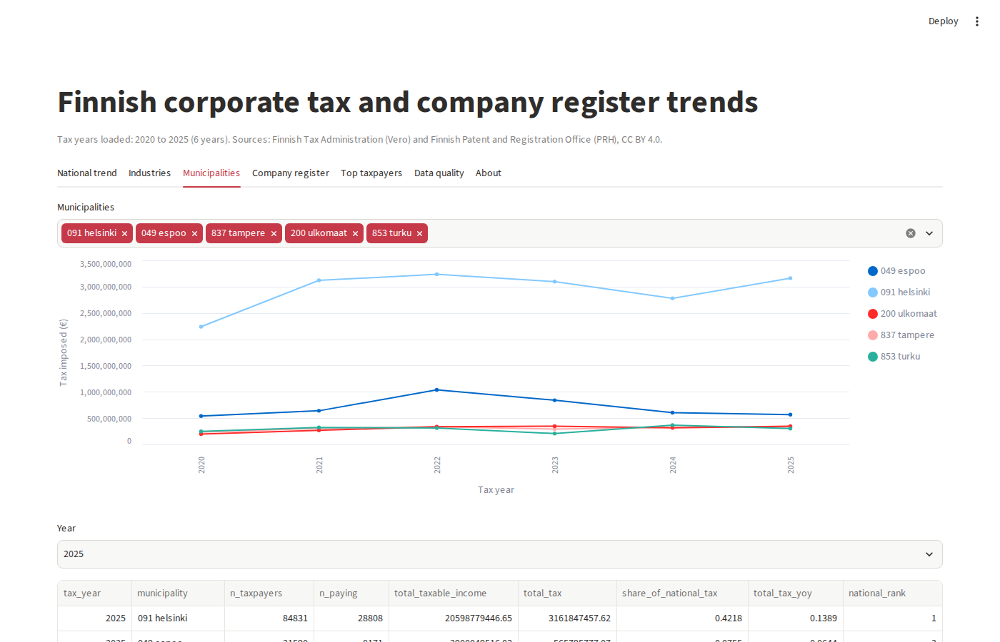
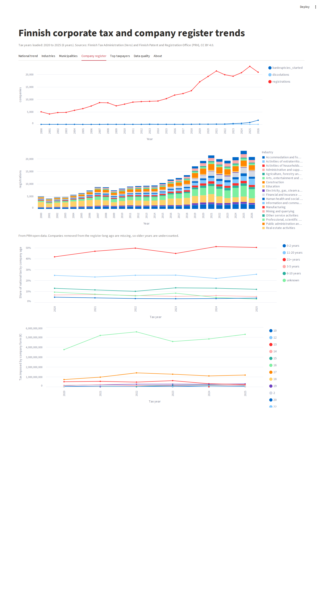
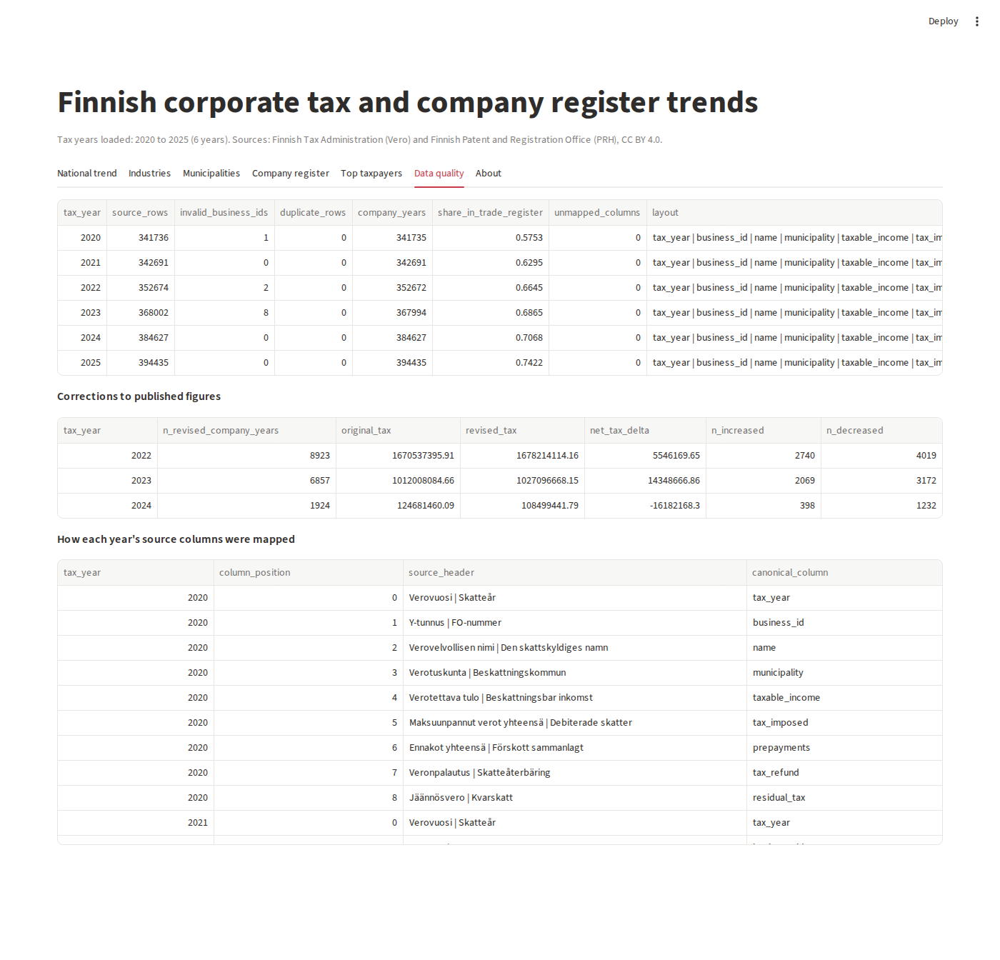

# Finnish corporate tax and company register trends

[](https://github.com/munyingi/Bussiness-operations/actions/workflows/ci.yml)

How has corporate income tax in Finland developed since 2011, and how does it connect to the companies behind it? This project joins the Finnish Tax Administration's (Vero) public corporate tax data with the Finnish Patent and Registration Office's (PRH) company register, and tracks the trends year by year.

**Live dashboard:** [bussiness-operations.streamlit.app](https://bussiness-operations.streamlit.app)



<details>
<summary>More screenshots</summary>








</details>

## Questions it answers

- How have total corporate tax, the number of taxpayers and the share paying any tax changed year by year?
- How concentrated is the tax base: what share do the top 1% and 10% pay?
- Which industries and municipalities pay the most, and how has that shifted?
- How many companies are registered, dissolved or enter bankruptcy each year, by industry?
- Do young or established companies carry the tax base?
- Who are the largest taxpayers each year, and how do their ranks move?
- How much are published figures corrected afterwards?

## Data

| Source | What | Licence |
|---|---|---|
| [Vero open data](https://www.vero.fi/avoindata) | Corporate income tax per company: Business ID, name, home municipality, taxable income, tax imposed. One CSV per tax year, plus a file of later corrections. | CC BY 4.0 |
| [PRH open data](https://avoindata.prh.fi/en) | Trade Register: company form, industry (TOL 2008), registration and end dates, bankruptcy and liquidation events. | CC BY 4.0 |

The two are joined on the Business ID (Y-tunnus).

**Years available.** Vero currently keeps tax years **2020 onward** online. Links to older years in the national open data catalogue no longer work, so the pipeline skips them and logs which years are missing. If you obtain older files (for example from Vero on request), drop them into `data/manual/vero_history/` with the year in the file name and they are loaded automatically. The dashboard always shows which years are loaded.

## How it works

```
Vero CSVs (one per tax year) ──┐
                               ├── ingestion/ (Python) ──► DuckDB raw.* ──► dbt ──► Streamlit
PRH Trade Register ZIP ────────┘    header mapping,                  staging
                                    Business ID check digit,         intermediate (company × year)
                                    encoding / delimiter detection   marts (10 trend tables)
```

**Engineering points:**
1. **Schema drift.** Vero's column names, order, encoding and delimiters vary between years. Headers are mapped to one schema by keyword rules, every mapping is stored, and a dbt test fails the build if a year loses a required column.
2. **Business ID validation** with the check digit before any join; invalid IDs are counted, not dropped silently.
3. **Survivorship bias.** PRH open data covers the Trade Register only, so the join is a LEFT join and unmatched taxpayers are labelled `not_in_trade_register`.
4. **Corrections.** Original and corrected figures are kept side by side.
5. **Resilience.** Dead source links are skipped with a warning instead of failing the whole run.

### Marts

| Model | Grain |
|---|---|
| `mart_yearly_trend` | year: totals, taxpayers, paying share, top 1% / 10% share, year-on-year change |
| `mart_industry_trend` | year × industry |
| `mart_municipality_trend` | year × municipality |
| `mart_company_form_trend` | year × company form |
| `mart_company_age_trend` | year × company age band |
| `mart_registration_trend` | year × industry: registrations, dissolutions, bankruptcies started |
| `mart_entry_exit_trend` | year: companies entering and leaving the tax data |
| `mart_top_taxpayers` | year × top 25 companies, with previous rank |
| `mart_revisions_trend` | year: corrections to published figures |
| `mart_data_quality` | year: rows, invalid IDs, duplicates, register match rate, header layout |

## Run it

```bash
git clone https://github.com/munyingi/Bussiness-operations.git
cd Bussiness-operations
python -m venv .venv && source .venv/bin/activate
make install

make live      # download the real data and build (needs internet)
make app       # open the dashboard

make sample    # or: run offline on synthetic sample data
make test      # unit tests
```

GitHub Actions runs the tests on every push. **Actions → Refresh live data** downloads the real data on GitHub's servers, builds the warehouse, and commits a small dashboard database (`data/app/trends_app.duckdb`) plus fresh screenshots. Streamlit Community Cloud serves the dashboard from that file, so the hosted app always shows the latest real data.

## Caveats

- Taxable income is not profit, and zero tax is often legitimate (losses, losses carried forward).
- Housing companies and mutual real estate companies are not in Vero's open data.
- Industry is the company's current industry in PRH, applied to every year.
- Municipality is the home municipality on Vero's list, not where the activity happens.
- PRH open data misses companies removed from the register long ago, so register counts for older years are lower bounds.

---

Built by [Samwel Munyingi](https://www.linkedin.com/in/samwel-munyingi-352a88161). Code: MIT licence. Data: Finnish Tax Administration and Finnish Patent and Registration Office, CC BY 4.0.
